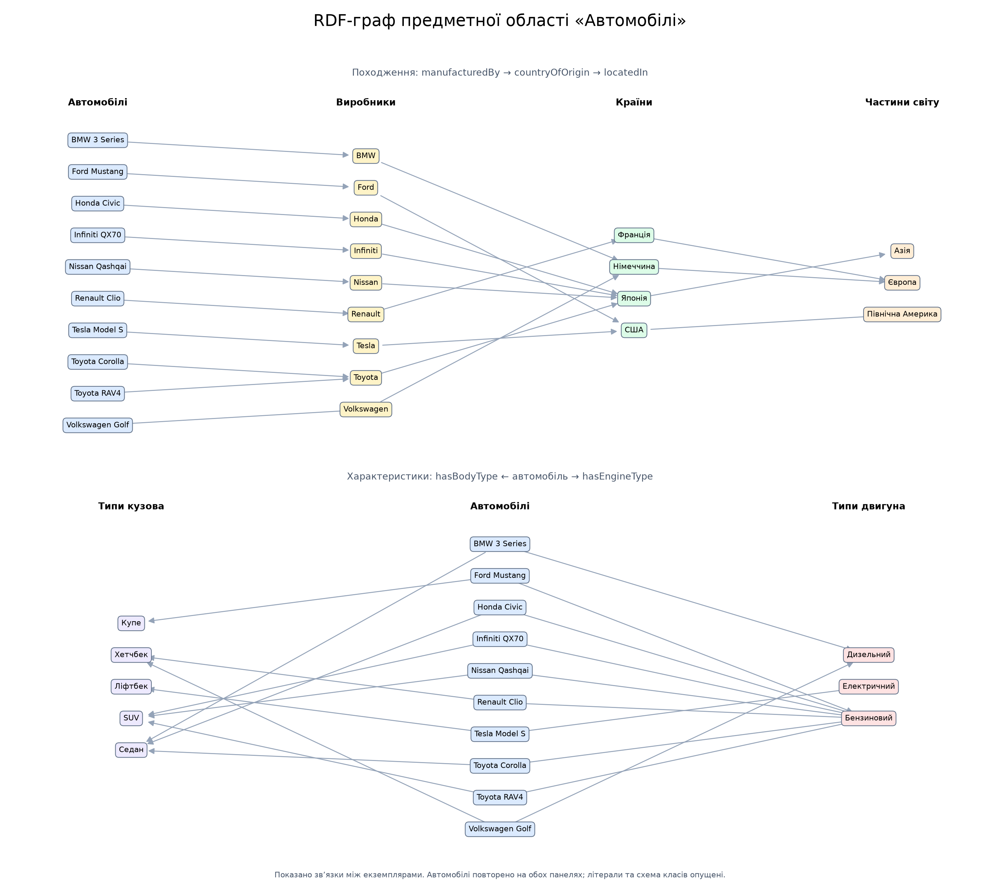

# Лабораторна робота №1: RDF та SPARQL

Предметна область — навчальний каталог автомобілів різних виробників із роками випуску до 2015 року. Граф описує назви, роки, виробників, країни походження, кузови та двигуни.

Дані сформовано вручну для демонстрації Semantic Web. Рік і двигун описують вибраний приклад комплектації, а не весь період виробництва моделі. Виробники та марки представлені спрощено. Для зовнішніх зв’язків використано Wikidata: [Японія](https://www.wikidata.org/wiki/Q17) та [Німеччина](https://www.wikidata.org/wiki/Q183).

## Запуск

Потрібен Python 3.10 або новіший. Команди виконуються з папки `Lab1`.

Windows (PowerShell), без активації середовища:

```powershell
py -m venv .venv
.\.venv\Scripts\python.exe -m pip install -r requirements.txt
.\.venv\Scripts\python.exe main.py
```

Linux / macOS:

```bash
python3 -m venv .venv
.venv/bin/python -m pip install -r requirements.txt
.venv/bin/python main.py
```

Звичайний запуск працює без інтернету після встановлення залежностей. Для виконання федеративного запиту додайте `--federated` до команди запуску. 
За помилки Wikidata програма завершується з кодом 1, повідомляє причину й не перезаписує попередній результат.

## Структура коду та розширення

| Файл | Призначення |
|---|---|
| [main.py](main.py) | Параметри командного рядка та послідовність запуску |
| [config.py](config.py) | Шляхи, RDF-простори імен, таймаут, сутність для демонстрації |
| [catalog_data.py](catalog_data.py) | Автомобілі, виробники, країни, характеристики та зовнішні ідентифікатори |
| [graph_builder.py](graph_builder.py) | Класи, предикати й побудова RDF-графу |
| [graph_io.py](graph_io.py) | Turtle, JSON-LD та консольний вивід |
| [query_runner.py](query_runner.py) | Читання запитів із файлів та виконання |
| [visualization.py](visualization.py) | Побудова PNG-схеми |
| `queries/*.rq` | Окремі тексти SPARQL-запитів |

Для нового локального SELECT-запиту достатньо додати файл, наприклад `09_new_query.rq`, у `queries/`: програма підхопить його автоматично. 
Для зміни запиту редагуйте відповідний `.rq`, а не Python-код. 
URL сервісу Wikidata й обмеження `VALUES` залишаються у федеративному `.rq`; при додаванні зовнішніх зв’язків оновіть також цей список.

Нові записи додавайте до `catalog_data.py`. Початкові Turtle та JSON-LD оновлюються під час запуску, але `output/cars_edited.ttl` зберігає ручні зміни. Щоб аналізувати розширений каталог, перенесіть потрібні трійки у цей файл або збережіть його резервну копію й приберіть його з `output/`: наступний запуск створить нову копію початкового графу. Після цього повторіть ручне редагування, потрібне за умовою лабораторної.

Поділ на модулі зберігає вимоги лабораторної: RDF будується засобами Python/RDFLib, усі серіалізації, візуалізація та SPARQL-запити доступні через `main.py`.

## Структура графу

Граф містить 6 класів і 34 екземпляри: 10 автомобілів, 9 виробників, 4 країни, 3 частини світу, 5 типів кузова та 3 типи двигуна. Початковий граф містить 166 трійок; відредагований — 167.

| Предикат | Перехід |
|---|---|
| `cars:manufacturedBy` | Автомобіль → виробник |
| `cars:countryOfOrigin` | Виробник → країна |
| `cars:locatedIn` | Країна → частина світу |
| `cars:hasBodyType` | Автомобіль → кузов |
| `cars:hasEngineType` | Автомобіль → двигун |

Власні URI мають основу `http://example.org/cars/`. Використано Schema.org, FOAF, Dublin Core, RDF, RDFS, OWL та XSD.



Дві панелі показують походження та характеристики автомобілів. Повторені автомобілі на панелях є тими самими ресурсами; літерали, декларації класів і зовнішні URI опущено для читабельності.

## Серіалізація та редагування

`main.py` зберігає початковий граф у [Turtle](output/cars_original.ttl) і [JSON-LD](output/cars.jsonld), потім читає [відредагований Turtle](output/cars_edited.ttl). Саме з нього формуються схема, консольний вивід та результати локальних запитів. Наявний відредагований файл не перезаписується.

Приклад трійок:

```turtle
@prefix cars: <http://example.org/cars/> .
@prefix schema: <https://schema.org/> .
@prefix xsd: <http://www.w3.org/2001/XMLSchema#> .

cars:ToyotaCorolla a cars:Car ;
    schema:name "Toyota Corolla" ;
    schema:productionDate "2013"^^xsd:gYear ;
    cars:manufacturedBy cars:Toyota .
```

У `cars_edited.ttl` текстовим редагуванням додано одну трійку:

```turtle
@prefix dcterms: <http://purl.org/dc/terms/> .
@prefix cars: <http://example.org/cars/> .
cars:ToyotaCorolla dcterms:description "Приклад седана у навчальному каталозі."@uk .
```

Для демонстрації на захисті можна змінити цей опис у файлі й повторно запустити програму: оновлена трійка з’явиться у виводі вибраної сутності.

## Питання та SPARQL-запити

| Питання | Текст запиту | Прийом |
|---|---|---|
| Які автомобілі мають рік випуску 2013–2014? | [01](queries/01_cars_2013_2014.rq) | FILTER, сортування |
| Які автомобілі мають кузов SUV? | [02](queries/02_suv_cars.rq) | Відбір за зв’язком |
| Які автомобілі належать виробникам із Японії? | [03](queries/03_japanese_cars.rq) | Перехід між сутностями |
| Скільки автомобілів представлено для кожного виробника? | [04](queries/04_count_by_manufacturer.rq) | COUNT, GROUP BY |
| Який середній рік випуску для кожного типу кузова? | [05](queries/05_avg_year_by_body.rq) | AVG, GROUP BY |
| Які автомобілі пов’язані з європейськими виробниками? | [06](queries/06_european_cars_three_links.rq) | Автомобіль → виробник → країна → Європа |
| Які бензинові автомобілі є в каталозі, від новіших до старіших? | [07](queries/07_petrol_sorted.rq) | Сортування |

Результати всіх семи запитів: [query_results.txt](output/query_results.txt). Тексти читаються безпосередньо з `queries/*.rq`. Програма не перезаписує ці файли. Локальні запити виконуються за алфавітом назв; федеративний файл, зазначений у `config.py`, виконується лише з `--federated`.

## Поєднання з Wikidata

| Локальний URI | Предикат | Зовнішній URI |
|---|---|---|
| `http://example.org/cars/Japan` | `owl:sameAs` | `http://www.wikidata.org/entity/Q17` |
| `http://example.org/cars/Germany` | `owl:sameAs` | `http://www.wikidata.org/entity/Q183` |

`owl:sameAs` використано, оскільки локальний і зовнішній ресурси позначають ту саму країну. `dcterms:source` вказує сторінку джерела. [Запит 08](queries/08_wikidata_federated.rq) поєднує локальні назви країн з англомовними назвами Wikidata через `SERVICE`; `VALUES` обмежує звернення двома потрібними ресурсами.

Стан перевірки та результат: [wikidata_query_result.txt](output/wikidata_query_result.txt).

## Помилка та висновки

[Помилковий і виправлений приклад](error_example.md) пояснює різницю між літералом і URI виробника.

RDF дозволяє подати каталог як пов’язані ресурси, а SPARQL — отримувати вибірки, підрахунки та відповіді через кілька переходів графу. Turtle зручний для читання й редагування; JSON-LD представляє той самий початковий граф в іншому форматі. Зовнішні URI зв’язують каталог із відкритими даними.

## Використання AI

AI використовувався для підготовки та редагування Python-коду, SPARQL-запитів, опису графу, документації й візуалізації
