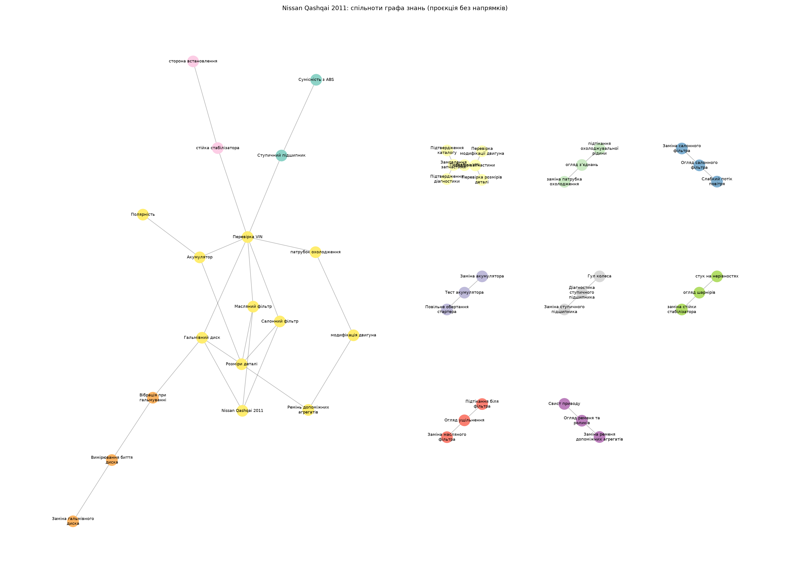

# Лабораторна робота №02
## LLM-екстракція знань, векторний пошук та GraphRAG

**Статус:** Виконано фактичну LLM-екстракцію, семантичний пошук та LLM map-reduce.

### 1. Предметна область і джерела
Підбір і діагностика запчастин Nissan Qashqai 2011. Власний корпус: 10
зв’язних українських документів, 1367 слів.
Варіант завдання з 8–10 документами не потребує 6000 слів.
Авторські навчальні сценарії містяться в `corpus/`; вони не є фактичними сервісними
історіями чи каталогом сумісності. EDU-коди вигадані для точного пошуку.
Зовнішні довідкові посилання й межі їх використання наведено в [аналізі результатів](../../REPORT.md).
Запитання (3 прості, 2 глобальні, перефразування, точний код та англомовний запит
до українського корпусу) — `questions.json`.

### 2. Схема та екстракція
Pydantic-схема: vehicle, part, symptom, procedure, criterion.
Зв’язки: HAS_PART, HAS_SYMPTOM, CHECKED_BY, REQUIRES, SELECTED_BY, PRECEDES.
HAS_SYMPTOM означає напрямок перевірки, а не однозначну причинність.
Кожний факт має doc_id і дослівну цитату. Цитата перевіряється програмно;
її наявність сама по собі не доводить правильність інтерпретації зв’язку.
Після нормалізації та дедуплікації отримано 45 фактів.

- [01_selection] (fact f001) Nissan Qashqai 2011 — HAS_PART → Масляний фільтр. Цитата: Nissan Qashqai 2011 має масляний фільтр.
- [01_selection] (fact f002) Nissan Qashqai 2011 — HAS_PART → Салонний фільтр. Цитата: Nissan Qashqai 2011 має салонний фільтр.
- [01_selection] (fact f003) Nissan Qashqai 2011 — HAS_PART → Гальмівний диск. Цитата: Nissan Qashqai 2011 має гальмівний диск.
- [01_selection] (fact f004) Підбір запчастини — REQUIRES → Перевірка VIN. Цитата: Підбір запчастини вимагає перевірки VIN.
- [01_selection] (fact f005) Підбір запчастини — REQUIRES → Перевірка модифікації двигуна. Цитата: Підбір запчастини вимагає перевірки модифікації двигуна.
- [01_selection] (fact f006) Підбір запчастини — REQUIRES → Перевірка розмірів деталі. Цитата: Підбір запчастини вимагає перевірки розмірів деталі.

Вибірка: 20 фактів, seed=42. Повністю коректні: **20/20 (100%)**; помилкові: **0**. Критерій суворий: зміст, сутності та їхні типи, відношення, напрям і підтвердження оригінальним текстом мають бути правильними. Синонімічні назви дозволені без зміни змісту. Частка стосується цієї вибірки, а не автоматично всіх 45 фактів.

Змістову перевірку 2026-10-21 виконав асистент на прохання користувача; це не окремий незалежний аудит людиною. Усі 20 оцінок і пояснення збережено в `manual_review.csv`; методика й граничні випадки — [аналіз результатів](../../REPORT.md). Початкові LLM-факти не змінено.

У перевірених 20 фактах помилок не виявлено.

Охоплення V2: 77 кандидатів, 45 прийнятих, 29 відхилених, 3 дублікати; джерела — 10/10 документів. Відхилення суворим фільтром не обов’язково означає хибність твердження; частина правильних перефразувань також може не пройти обмеження. Порівняння з V1 (8/20 = 40%) наведено в [аналіз результатів](../../REPORT.md).

### 3. Чанки та пошук
Чанки: 140 слів, перекриття 30 слів, без переходу через межі документа.
Такий розмір відповідає компактним сценаріям і зберігає контекст діагностики;
перекриття допомагає утримати зв’язки на межі фрагментів.
Keyword: TF-IDF; точний EDU-код додатково отримує бонус за дослівний збіг.
Семантичний режим: Gemini Embedding, локальна багатомовна SentenceTransformer або Ollama Embedding.
Вектори нормалізуються; numpy.dot реалізує cosine similarity. Артефакти:
`embeddings.npy`, `chunks.json`, `vector_store.json`.

| Запит | Метод | Hit@1 | Recall@3 | Документи top-3 |
|---|---|---:|---:|---|
| q1 | keyword | 1 | 1.00 | 03_cabin_filter, 01_selection, 02_oil_filter |
| q1 | vector | 0 | 1.00 | 01_selection, 02_oil_filter, 03_cabin_filter |
| q2 | keyword | 1 | 1.00 | 04_brakes, 05_suspension, 02_oil_filter |
| q2 | vector | 1 | 1.00 | 04_brakes, 01_selection, 10_order |
| q3 | keyword | 1 | 1.00 | 06_bearing, 04_brakes, 10_order |
| q3 | vector | 1 | 1.00 | 06_bearing, 01_selection, 05_suspension |
| q6 | keyword | 0 | 1.00 | 06_bearing, 03_cabin_filter, 07_cooling |
| q6 | vector | 0 | 1.00 | 01_selection, 02_oil_filter, 03_cabin_filter |
| q7 | keyword | 1 | 1.00 | 03_cabin_filter, 01_selection, 01_selection |
| q7 | vector | 0 | 1.00 | 01_selection, 03_cabin_filter, 02_oil_filter |
| q8 | keyword | 0 | 0.00 | 01_selection, 01_selection, 02_oil_filter |
| q8 | vector | 1 | 1.00 | 03_cabin_filter, 01_selection, 02_oil_filter |

q6 перевіряє перефразування, q7 — точний код, q8 — міжмовний пошук.
Висновок про виграш чи програш
семантичного пошуку допустимий лише після фактичного запуску та перегляду
`search_comparison.json`. Якщо q6/q7 не показують потрібного контрасту, слід
додати інші перефразування або точні коди й повторити дослід; результат не підганяти.

### 4. Граф і GraphRAG
Фактичний розбір результатів локального запуску, пошукові виграші/програші та
перевірені приклади семантичних помилок: [аналіз результатів](../../REPORT.md).
MultiDiGraph: 46 вузлів, 45 ребер.
Паралельні ребра зберігають різні відношення і джерела. Louvain, seed=42:
12 спільнот у зваженій ненапрямленій проєкції.
Схема: `knowledge_graph.png`, інтерактивно масштабований SVG та GraphML.
Міжспільнотні ребра включаються в резюме, щоб не втратити спільні критерії VIN.
Map: те саме LLM підсумовує кожну спільноту; reduce: відповідає за всіма резюме.
Vector-RAG передає тому самому LLM тільки top-3 чанки без графа.

#### GraphRAG
Повторювані перевірки під час підбору запчастин — це огляд ущільнення, огляд салонного фільтра, вимірювання биття диска, огляд шарнірів, огляд ременя та роликів, огляд з’єднань та тест акумулятора.  

Підтверджені факти:  
- Перевірка VIN повторюється для підбору ступичного підшипника [06_bearing] (f027), гальмівного диска [05_suspension] (f023) та стійки стабілізатора [05_suspension] (f023).  
- Перевірка розмірів деталі повторюється для масляного фільтра, салонного фільтра та гальмівного диску.  
- Перевірка модифікації двигуна використовується при підборі ременя [08_belt] (f033).  
- Тест акумулятора виконується для перевірки повільного обертання стартера [09_battery] (f037).  

Узагальнення:  
- Усі деталі підбираються за VIN або розмірами, окрім ременя (за модифікацією двигуна та розмірами) і акумулятора (за полярністю, розмірами та VIN).  
- Симптоми (наприклад, вібрація при гальмуванні, стук на нерівностях) пов’язані з конкретними перевірками: вібрація — через вимірювання биття диска; стук — через огляд шарнірів.  
- Діагностика (наприклад, діагностика ступичного підшипника) передує заміною деталі [06_bearing] (f026).  

Обмеження:  
- Контекст не містить інформації про те, які перевірки повторюються під час підбору різних запчастин у загальному випадку.  
- Немає прямих даних про зв’язок між симптомами, діагностикою та заміною для всіх типів деталей — це встановлено лише для кількох конкретних випадків.  
- Немає інформації про те, чи є спільні перевірки для різних типів запчастин (наприклад, чи всі деталі підлягають одному типу огляду).  

Висновок:  
Перевірки повторюються за конкретними випадками (VIN, розміри, огляд, тест), але не є систематичними для всіх запчастин. Симптоми пов’язані з діагностикою, яка передує заміні, але це встановлено лише для певних деталей.

#### Vector-RAG
Повторювані перевірки під час підбору запчастин:  
- Перевірка VIN [01_selection][10_order]  
- Перевірка модифікації двигуна [01_selection]  
- Перевірка розмірів деталі [01_selection]  
- Підтвердження діагностики перед замовленням запчастини [10_order]  
- Підтвердження каталогу перед замовленням запчастини [10_order]  

Симптоми, діагностика та заміна пов’язані так:  
Діагностичні скарги (наприклад, слабкий потік повітря, вібрація при гальмуванні, гул колеса) приводять до формування конкретних напрямків перевірки (вентиляція салону, гальмівний вузол, ступичний вузол). Працівник не вважає, що скарги автоматично означають три доведені несправності. Загальна логіка діагностики і сумісності деталей об’єднується у підсумковий висновок перед замовленням [10_order].  

Узагальнення:  
Сукупність спільнот може узагальнити повторювані критерії для різних вузлів, але це не підтверджено в контексті як конкретна логіка з’єднання симптомів, діагностики та заміни [10_order].  

Обмеження:  
- У навчальних текстах немає достовірних OEM-номерів, моментів затягування чи універсальних інтервалів заміни [01_selection]  
- Перелік внутрішніх кодів EDU не є каталогом виробника і не замінює перевірку реального автомобіля [10_order]  
- Немає даних про конкретну залежність між симптомами, діагностикою та процесом заміни запчастини як вимірюваного механізму.

#### Порівняння
Оцінювати слід покриття перевірки VIN, двигуна, розмірів, ABS, полярності,
сторони встановлення, діагностики та каталожного підтвердження. Окремо перевірити
кожне узагальнення за кількома doc_id. Граф може охоплювати більше систем,
але резюме може втрачати деталі. Vector-RAG обмежений трьома фрагментами.
У демонстрації перелік фактів і TF-IDF-контекст не є LLM-відповідями; оцінка
повноти реальних відповідей у demo не виконана. Для збереженого локального
live-запуску конкретні висновки наведено в REPORT.md; при зміні корпусу або
моделі їх потрібно переглянути за новими відповідями.

### 5. Помилковий та виправлений приклад
Фактичні помилки моделей, приклади цитат, повторень і вибору Thinking/Instruct
описано в [аналізі результатів](../../REPORT.md). Наявність точної цитати не гарантує
правильної спрямованості ребра або збереження заперечення.
Реальна проблема середовища: команда `python` посилалась на недоступний Windows
App Execution Alias. Виправлення: запуск через `.venv/Scripts/python.exe`.
Під час налаштування Ollama 0.40.0 моделі завантажились, але API повертав порожній
список: журнал фіксував `The path cannot be traversed because it contains an
untrusted mount point` для символьних посилань `manifests-v2`. Два службові
посилання замінено звичайними файлами з тим самим вмістом; оригінали збережено
як `.symlink-backup`. Після виправлення API побачив обидві моделі; тест
`check_ollama.py` підтвердив JSON-екстракцію та ембединґи розмірності 1024.
Додатковий контрольований приклад, а не помилка LLM: два ідентифікатори
для «Перевірка VIN» і « перевірка VIN » створювали б два вузли. Канонізація
NFKC + casefold + нормалізація пробілів та ключ (тип, назва) зливає їх.
Перевірка `--self-check` відтворює цей випадок, відхиляє вигадану цитату
і перевіряє правильність точного пошуку.

### 6. Висновки
Корпус придатний для поєднання фактів з різних систем через спільні критерії
підбору. Збереження цитат забезпечує перевірюваність, але не замінює ручний аудит.
Змістову перевірку вибірки завершено; отриману оцінку слід враховувати під час інтерпретації GraphRAG: правильна цитата не гарантує правильного ребра.
